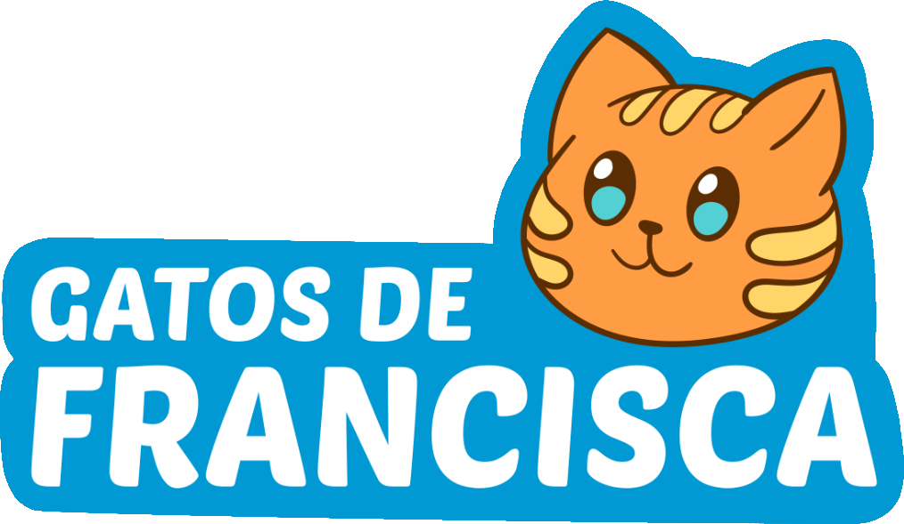
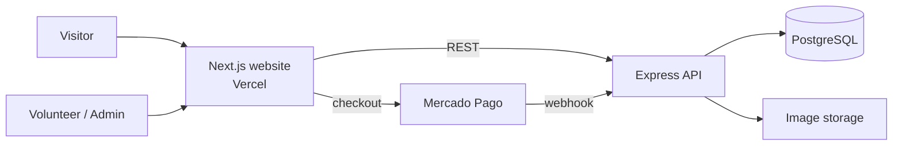

<div align="center">



# Gatos de Francisca — Cat Shelter Website

A full-stack website for **Gatos de Francisca**, a cat shelter in Rio de Janeiro, Brazil.
It presents the shelter, showcases cats available for adoption, explains how people can help
and will include an online store whose sales fund the shelter.


**[Live demo](#)** _(coming soon)_

</div>

---

## Table of contents

- [About](#about)
- [Features](#features)
- [Tech stack](#tech-stack)
- [Architecture](#architecture)
- [Project structure](#project-structure)
- [Getting started](#getting-started)
- [Configuration](#configuration)
- [Design system](#design-system)
- [Technical highlights](#technical-highlights)
- [Deployment](#deployment)
- [Roadmap](#roadmap)
- [Commit convention](#commit-convention)
- [Author](#author)
- [License](#license)

---

## About

Gatos de Francisca rescues, cares for and rehomes cats. Most of its communication happens on
Instagram, which makes it hard to keep an organized, searchable list of the cats waiting for a
home. This project gives the shelter its own website, with:

- a public site to present the shelter, its cats and the ways to help;
- an admin area where volunteers manage the adoption listings without touching code;
- a small online store (and links to the shelter's thrift shop and used bookstore) to raise funds.

The project is built in stages, one section at a time, starting from wireframes and the shelter's
existing visual identity.

## Features

### Available now

- **Responsive layout** with a top bar, sticky header and footer
- **Multi-page navigation**: each section is its own route, with active menu highlighting,
  breadcrumbs, per-page SEO metadata and a custom 404 page
- **Home hero** with a looping video: side-by-side on desktop, full-screen background on mobile
- **Top bar** with tagline, WhatsApp link, Pix donation key (click to copy) and language switcher
- **Navigation** with a CSS-only dropdown (hover and keyboard accessible) and a mobile menu
- **Social links** to the shelter's Instagram, Facebook, thrift shop and used bookstore
- **Brand identity**: Chewy for headings, Geist for body text, custom paw cursor
- **Decorative background** with a seamless paw/fish/bone pattern on the side margins
- **SEO foundations**: metadata, Open Graph tags, `pt-BR` language, canonical URL

### In progress / planned

See the [roadmap](#roadmap).

## Tech stack

| Layer | Technology | Status |
|---|---|---|
| Frontend | [Next.js 16](https://nextjs.org/) (App Router, Cache Components) · React 19 · TypeScript | ✅ |
| Styling | [Tailwind CSS 4](https://tailwindcss.com/) | ✅ |
| Fonts | `next/font` (self-hosted Google Fonts) | ✅ |
| Hosting (frontend) | [Vercel](https://vercel.com/) | ✅ |
| API | Node.js + Express (REST) | 🔜 |
| Database | PostgreSQL (Supabase or Neon) + Prisma ORM | 🔜 |
| Auth | Hashed passwords (bcrypt/argon2) + JWT in httpOnly cookies, role-based access | 🔜 |
| Images | Cloudinary or Supabase Storage | 🔜 |
| Payments | Mercado Pago (Pix, card, boleto) with webhooks | 🔜 |

**Why PostgreSQL instead of NoSQL?** The data is highly relational — users with roles, cats with
photos and adoption status, products, orders and order items. The store needs transactions
(create the order and decrease stock atomically), and exporting reports to Excel is a simple
SQL query.

## Architecture



The website and the API live in the same repository (monorepo), each in its own folder, so they
can be deployed independently.

## Project structure

```
.
├── web/                      # Next.js website
│   ├── app/
│   │   ├── components/       # Header, Footer, TopBar, icons, home/ and ui/ components
│   │   ├── content/          # Page content (texts, media) — will move to the database
│   │   ├── lib/site.ts       # Central config: navigation, contacts, social links
│   │   ├── globals.css       # Theme tokens, background pattern, cursor
│   │   ├── layout.tsx        # Root layout, fonts and SEO metadata
│   │   ├── page.tsx          # Home page
│   │   ├── quem-somos/       # /quem-somos
│   │   ├── como-ajudar/      # /como-ajudar + adote, voluntariado, lojinha, doacao, contas
│   │   ├── contato/          # /contato
│   │   └── not-found.tsx     # Custom 404
│   └── public/
│       ├── images/           # Logo and site images
│       ├── videos/           # Compressed hero video and poster
│       ├── cursors/          # Paw cursor (SVG)
│       └── patterns/         # Generated background pattern (SVG)
├── design/
│   └── pattern/              # Source SVGs, layout.json and generator script
├── api/                      # (planned) Express API
├── LICENSE
└── README.md
```

## Getting started

### Prerequisites

- Node.js **20.9 or newer**
- npm

### Run locally

```bash
git clone https://github.com/hadamas/cat-shelter-website-project.git
cd cat-shelter-website-project/web
npm install
npm run dev
```

Open [http://localhost:3000](http://localhost:3000).

### Scripts (inside `web/`)

| Command | Description |
|---|---|
| `npm run dev` | Start the development server |
| `npm run build` | Create a production build |
| `npm run start` | Serve the production build |
| `npm run lint` | Run ESLint |

## Configuration

### Site content

Navigation items, contact details and social links are centralized in
[`web/app/lib/site.ts`](web/app/lib/site.ts). The header, top bar and footer read from it, so a
change there updates the whole site.

### Environment variables

| Variable | Required | Description |
|---|---|---|
| `NEXT_PUBLIC_SITE_URL` | No | Public URL used for absolute links (Open Graph, canonical). Falls back to the Vercel production URL, then `http://localhost:3000`. |

More variables (API URL, database, payment keys) will be added as the backend is built.
Secrets must **never** use the `NEXT_PUBLIC_` prefix.

## Design system

| Token | Value | Usage |
|---|---|---|
| `main-orange` | `#fb9d45` | Primary accent, donation button, background tint |
| `main-blue` | `#0095d2` | Links, hover states, theme color |
| `main-brown` | `#5c2e0e` | Text (taken from the logo outline) |
| `font-display` | Chewy | Logo and headings |
| `font-sans` | Geist | Body text |

Colors are defined as Tailwind theme tokens in `globals.css`, so they work as utilities
(`bg-main-orange`, `text-main-blue/80`...).

### Background pattern

The side background is a single seamless SVG tile used as a **CSS mask**: the file only defines
the shapes, and the color comes from CSS. Changing the tone or density is a one-line edit:

```css
--pattern-color: color-mix(in srgb, var(--color-main-orange) 38%, white);
--pattern-size: 420px;
```

To change which objects appear and where, edit `design/pattern/layout.json` and regenerate:

```bash
python design/pattern/make.py
```

The script removes the white background added by Canva exports, reduces path precision and
duplicates objects across the tile edges so the pattern repeats without seams.

## Technical highlights

- **Server Components by default.** The header dropdown and the mobile menu work with CSS and
  `<details>` only; the single client component is the "copy Pix key" button.
- **Cache Components.** Values that change over time (such as the copyright year) are computed
  with `"use cache"` + `cacheLife`, keeping pages fully prerendered.
- **Font performance.** Fonts are downloaded at build time and served from the same domain, with
  only the needed weight and subset, avoiding layout shift.
- **Image performance.** The logo uses `next/image` with eager loading in the header (above the
  fold) and responsive sizes.
- **Active links without losing static rendering.** The menu highlights the current page with
  `usePathname` inside a small client component wrapped in `<Suspense>`, so the layout stays
  prerendered even on future dynamic routes.
- **Accessibility.** Semantic landmarks, `aria-label`s on icon-only buttons, keyboard-accessible
  dropdown, `aria-live` feedback when the Pix key is copied, and a fallback to the default cursor.
- **Content separated from components.** Texts and media live in `app/content/`, typed like the
  future database records, so making them editable by admins won't require touching the UI.
- **Lightweight hero video.** One `<video>` element repositioned with CSS (downloaded once), H.264
  MP4 trimmed to a 19-second loop and compressed, autoplaying muted with a `poster` image shown while it loads.
- **No icon library.** Icons are small inline SVG components, so no extra dependency or request.

## Deployment

The website is deployed on **Vercel** from the `main` branch:

- **Root Directory:** `web`
- Every push to `main` triggers a production deploy; every branch or pull request gets a preview URL.

## Roadmap

- [x] Project setup (Next.js 16, TypeScript, Tailwind 4, Vercel)
- [x] Visual identity: colors, fonts, cursor, background pattern
- [x] Top bar, header and footer
- [x] Multi-page routing for every section
- [x] Home hero
- [ ] Other home page sections from the wireframes
- [ ] "Quem Somos" (about) section
- [ ] "Como Ajudar" (how to help) section and dropdown options
- [ ] Contact section
- [ ] Search
- [ ] Database and REST API
- [ ] Volunteer login with role-based access (admin / volunteer)
- [ ] Adoption listings: create, edit, mark as adopted, export to Excel
- [ ] Individual cat pages with Open Graph images for sharing
- [ ] Online store with Mercado Pago checkout
- [ ] English version (i18n)
- [ ] Custom domain
- [ ] Sitemap, robots.txt and Google Search Console

## Commit convention

This project follows [Conventional Commits](https://www.conventionalcommits.org/):

| Prefix | Use |
|---|---|
| `feat:` | New feature or section |
| `fix:` | Bug fix |
| `style:` | Visual or CSS changes without behavior change |
| `refactor:` | Code change that neither fixes a bug nor adds a feature |
| `docs:` | Documentation |
| `chore:` | Tooling, dependencies, configuration |

## Author

**Alanis Hadama** — full-stack developer and volunteer at Gatos de Francisca

[LinkedIn](https://www.linkedin.com/in/alanis-hadama/) · [GitHub](https://github.com/hadamas)

## License

Code released under the [MIT License](LICENSE).

The **Gatos de Francisca** name, logo and visual identity belong to the shelter and are not
covered by the MIT License.
