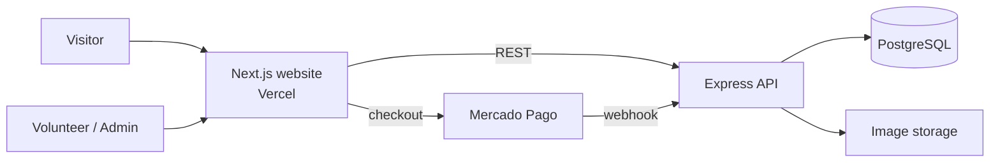

<div align="center">


# Gatos de Francisca — Cat Shelter Website

A full-stack website for **Gatos de Francisca**, a cat shelter in Rio de Janeiro, Brazil.
It presents the shelter, showcases cats available for adoption, explains how people can help
and will include an online store whose sales fund the shelter.


**[Live demo](#)** _(coming soon)_

</div>

---

## Table of contents

- [About](#about)
- [Features](#features)
- [Tech stack](#tech-stack)
- [Architecture](#architecture)
- [Project structure](#project-structure)
- [Getting started](#getting-started)
- [Configuration](#configuration)
- [Design system](#design-system)
- [Technical highlights](#technical-highlights)
- [Deployment](#deployment)
- [Roadmap](#roadmap)
- [Commit convention](#commit-convention)
- [Author](#author)
- [License](#license)

---

## About

Gatos de Francisca rescues, cares for and rehomes cats. Most of its communication happens on
Instagram, which makes it hard to keep an organized, searchable list of the cats waiting for a
home. This project gives the shelter its own website, with:

- a public site to present the shelter, its cats and the ways to help;
- an admin area where volunteers manage the adoption listings without touching code;
- a small online store (and links to the shelter's thrift shop and used bookstore) to raise funds.

The project is built in stages, one section at a time, starting from wireframes and the shelter's
existing visual identity.

## Features

### Available now

- **Responsive layout** with a top bar, sticky header and footer
- **Multi-page navigation**: each section is its own route, with active menu highlighting,
  breadcrumbs, per-page SEO metadata and a custom 404 page
- **Home hero** with a looping video: side-by-side on desktop, full-screen background on mobile
- **About page ("Quem Somos")**: hero, partners, help cards, story with a fading photo carousel,
  animated counters that start when scrolled into view, cat stories, a volunteers gallery and an
  embedded Google Maps location (no API key, lazy-loaded)
- **Contact page** with WhatsApp (opens the chat with a pre-filled message), Instagram and
  neighborhood, plus an image slot that falls back to a placeholder until a photo is added
- **Volunteer page**: weekly on-site roles with the shifts that need help most, occasional and
  remote roles, a 3-step "how to join" guide, and links to the sign-up form and WhatsApp
- **Donations page**: six ways to give (Pix, monthly contribution, supplies, Petz partner link
  with coupon, thrift shop and used bookstore), with copy-to-clipboard for the Pix key and coupon
- **Adoption page**: cat cards (photo, name, sex, age and time at the shelter calculated from
  dates) with sorting and responsive pagination kept in the URL, plus a page for each cat with a
  photo gallery, vet care, story and personality traits
- **Admin panel for adoption listings**: admins add and edit cats in a modal (photo upload with
  automatic resizing to WebP, date pickers, tag inputs for vet care and personality, story with a
  character counter, "adopted" switch). Adopted cats leave the listing but stay in the database
  (there is no delete). Pages update instantly through on-demand cache revalidation
- **Login for volunteers and admins**: sign in, forgot/reset password, invite-only accounts, and a user menu in the top bar with name and role
- **Top bar** with tagline, WhatsApp link, Pix donation key (click to copy) and language switcher
- **Navigation** with a CSS-only dropdown (hover and keyboard accessible) and a mobile menu
- **Social links** to the shelter's Instagram, Facebook, thrift shop and used bookstore
- **Brand identity**: Chewy for headings, Geist for body text, custom paw cursor
- **Decorative background** with a seamless paw/fish/bone pattern on the side margins
- **SEO**: per-page metadata, canonical URLs, generated `sitemap.xml` and `robots.txt`,
  a dynamic Open Graph share image, and `AnimalShelter` structured data (JSON-LD)

### In progress / planned

See the [roadmap](#roadmap).

## Tech stack

| Layer | Technology | Status |
|---|---|---|
| Frontend | [Next.js 16](https://nextjs.org/) (App Router, Cache Components) · React 19 · TypeScript | ✅ |
| Styling | [Tailwind CSS 4](https://tailwindcss.com/) | ✅ |
| Fonts | `next/font` (self-hosted Google Fonts) | ✅ |
| Hosting (frontend) | [Vercel](https://vercel.com/) | ✅ |
| API | Node.js + Express 5 + TypeScript (REST), Zod validation | 🚧 |
| Database | PostgreSQL (Supabase) + Drizzle ORM, SQL migrations | 🚧 |
| Auth | Supabase Auth (email/password, invites, password reset) + roles checked by the API (JWT verified with JWKS) | ✅ |
| Images | Cloudinary or Supabase Storage | 🔜 |
| Payments | Mercado Pago (Pix, card, boleto) with webhooks | 🔜 |

**Why PostgreSQL instead of NoSQL?** The data is highly relational — users with roles, cats with
photos and adoption status, products, orders and order items. The store needs transactions
(create the order and decrease stock atomically), and exporting reports to Excel is a simple
SQL query.

## Architecture



The website and the API live in the same repository (monorepo), each in its own folder, so they
can be deployed independently.

## Project structure

```
.
├── web/                      # Next.js website
│   ├── app/
│   │   ├── components/       # Header, Footer, TopBar, icons, home/ and ui/ components
│   │   ├── content/          # Page content (texts, media) — will move to the database
│   │   ├── lib/site.ts       # Central config: navigation, contacts, social links
│   │   ├── globals.css       # Theme tokens, background pattern, cursor
│   │   ├── layout.tsx        # Root layout, fonts and SEO metadata
│   │   ├── page.tsx          # Home page
│   │   ├── quem-somos/       # /quem-somos
│   │   ├── como-ajudar/      # /como-ajudar + adote, voluntariado, lojinha, doacao, contas
│   │   ├── contato/          # /contato
│   │   ├── not-found.tsx     # Custom 404
│   │   ├── sitemap.ts        # /sitemap.xml
│   │   ├── robots.ts         # /robots.txt
│   │   └── opengraph-image.tsx # Share image for social media
│   ├── assets/fonts/         # Font used to generate the Open Graph image
│   └── public/
│       ├── images/           # Logo and site images
│       ├── videos/           # Compressed hero video and poster
│       ├── cursors/          # Paw cursor (SVG)
│       └── patterns/         # Generated background pattern (SVG)
├── design/
│   └── pattern/              # Source SVGs, layout.json and generator script
├── api/                      # Express API
│   ├── src/
│   │   ├── db/schema.ts      # Tables: cats, cat_photos, users
│   │   ├── db/seed.ts        # Example data
│   │   ├── routes/cats.ts    # GET /cats, GET /cats/:slug
│   │   ├── app.ts            # Express app (CORS, JSON, errors)
│   │   └── env.ts            # Environment variables validated with Zod
│   └── drizzle/              # Generated SQL migrations
├── LICENSE
└── README.md
```

## Getting started

### Prerequisites

- Node.js **20.9 or newer**
- npm

### Run locally

```bash
git clone https://github.com/hadamas/cat-shelter-website-project.git
cd cat-shelter-website-project/web
npm install
npm run dev
```

Open [http://localhost:3000](http://localhost:3000).

### Scripts (inside `web/`)

| Command | Description |
|---|---|
| `npm run dev` | Start the development server |
| `npm run build` | Create a production build |
| `npm run start` | Serve the production build |
| `npm run lint` | Run ESLint |

### Run the website with the API

The adoption pages read the cats from the API, so start the API first (see below) and create
`web/.env.local` with `API_URL=http://localhost:3333`.

### Run the API locally

```bash
cd api
cp .env.example .env      # then fill DATABASE_URL
npm install
npm run db:migrate        # create the tables
npm run db:seed -- --apagar-tudo   # optional: example cats (deletes ALL cats first)
npm run dev               # http://localhost:3333
```

| Endpoint | Description |
|---|---|
| `GET /health` | API and database status |
| `GET /cats?status=disponivel` | Cats by status (`disponivel` or `adotado`), with photos |
| `GET /cats/:slug` | One cat |
| `POST /cats` | Create a cat (admin only) |
| `PUT /cats/:id` | Edit a cat, including marking it as adopted (admin only) |
| `GET /me` | Logged-in user (requires `Authorization: Bearer <token>`) |

Give someone access (sends an invite email if they don't have an account yet):

```bash
npm run users:grant -- email@example.com "Name" admin   # or volunteer
```

**Why Drizzle?** The schema is plain TypeScript, migrations are readable SQL files versioned in git, and there is no generated client or native binary to download.

## Configuration

### Site content

Navigation items, contact details and social links are centralized in
[`web/app/lib/site.ts`](web/app/lib/site.ts). The header, top bar and footer read from it, so a
change there updates the whole site.

### Environment variables

| Variable | Required | Description |
|---|---|---|
| `NEXT_PUBLIC_SITE_URL` | No | Public URL used for absolute links (Open Graph, canonical, sitemap). Falls back to the Vercel production URL, then `http://localhost:3000`. |
| `GOOGLE_SITE_VERIFICATION` | No | Google Search Console verification code (rendered as a meta tag). |
| `NEXT_PUBLIC_API_URL` | Yes | Base URL of the API (`http://localhost:3333` locally). |
| `NEXT_PUBLIC_SUPABASE_URL` | Yes | Supabase project URL (login). |
| `NEXT_PUBLIC_SUPABASE_PUBLISHABLE_KEY` | Yes | Supabase publishable key (public by design). |

More variables (API URL, database, payment keys) will be added as the backend is built.
Secrets must **never** use the `NEXT_PUBLIC_` prefix.

## Design system

| Token | Value | Usage |
|---|---|---|
| `main-orange` | `#fb9d45` | Primary accent, donation button, background tint |
| `main-blue` | `#0095d2` | Links, hover states, theme color |
| `main-brown` | `#5c2e0e` | Text (taken from the logo outline) |
| `font-display` | Chewy | Logo and headings |
| `font-sans` | Geist | Body text |

Colors are defined as Tailwind theme tokens in `globals.css`, so they work as utilities
(`bg-main-orange`, `text-main-blue/80`...).

### Background pattern

The side background is a single seamless SVG tile used as a **CSS mask**: the file only defines
the shapes, and the color comes from CSS. Changing the tone or density is a one-line edit:

```css
--pattern-color: color-mix(in srgb, var(--color-main-orange) 38%, white);
--pattern-size: 420px;
```

To change which objects appear and where, edit `design/pattern/layout.json` and regenerate:

```bash
python design/pattern/make.py
```

The script removes the white background added by Canva exports, reduces path precision and
duplicates objects across the tile edges so the pattern repeats without seams.

## Technical highlights

- **Server Components by default.** The header dropdown and the mobile menu work with CSS and
  `<details>` only; the single client component is the "copy Pix key" button.
- **Cache Components.** Values that change over time (such as the copyright year) are computed
  with `"use cache"` + `cacheLife`, keeping pages fully prerendered.
- **Font performance.** Fonts are downloaded at build time and served from the same domain, with
  only the needed weight and subset, avoiding layout shift.
- **Image performance.** The logo uses `next/image` with eager loading in the header (above the
  fold) and responsive sizes.
- **Active links without losing static rendering.** The menu highlights the current page with
  `usePathname` inside a small client component wrapped in `<Suspense>`, so the layout stays
  prerendered even on future dynamic routes.
- **Accessibility.** Semantic landmarks, `aria-label`s on icon-only buttons, keyboard-accessible
  dropdown, `aria-live` feedback when the Pix key is copied, and a fallback to the default cursor.
- **Content separated from components.** Texts and media live in `app/content/`, typed like the
  future database records, so making them editable by admins won't require touching the UI.
- **Lightweight hero video.** One `<video>` element repositioned with CSS (downloaded once), H.264
  MP4 trimmed to a 19-second loop and compressed, autoplaying muted with a `poster` image shown while it loads.
- **Scroll-triggered counters.** `IntersectionObserver` starts the count once; numbers are
  updated straight in the DOM with `requestAnimationFrame` (no re-render per frame), the final
  value is in the server HTML for SEO, and screen readers only hear the final number.
- **Data access layer for cats.** Pages call `getAvailableCats()` / `getCatBySlug()` in
  `app/lib/cats.ts`; today they return example data, later they will call the API — no UI changes.
- **Sorting and pagination in the URL** (`?ordem=nome&pagina=2`), so links can be shared and the
  back button works. Page size follows the grid (16 on mobile, 6 on tablet, 8 on desktop).
- **Static cat pages** generated with `generateStaticParams`, each with its own metadata and share
  image, and included in the sitemap.
- **Database security on Supabase.** Row Level Security is enabled on every table with no
  policies, so Supabase's auto-generated public API can't read or write the data — only our API, connecting as the database owner, can.
- **Authentication vs. authorization.** Supabase Auth handles accounts and sessions; the API
  verifies each token's signature against Supabase's public keys (JWKS, via `jose`), checks issuer,
  audience and expiry, then loads the user's role from our own `users` table. Accounts are
  invite-only and roles live in our database, so access can be revoked at any time.
- **CORS with wildcards** so Vercel preview deployments can call the API without opening it to
  every site.
- **No icon library.** Icons are small inline SVG components, so no extra dependency or request.

## Deployment

Both apps are deployed on **Vercel** as two projects from the same repository.

**API** (`api/`, Express detected automatically): Root Directory `api`, environment variables
`DATABASE_URL` (Supabase transaction pooler, port 6543), `DB_POOL_MAX=3` and `WEB_ORIGIN`.

**Website** (`web/`):

- **Root Directory:** `web`
- Every push to `main` triggers a production deploy; every branch or pull request gets a preview URL.

## Roadmap

- [x] Project setup (Next.js 16, TypeScript, Tailwind 4, Vercel)
- [x] Visual identity: colors, fonts, cursor, background pattern
- [x] Top bar, header and footer
- [x] Multi-page routing for every section
- [x] Home hero
- [ ] Other home page sections from the wireframes
- [x] "Quem Somos" (about) page
- [ ] "Como Ajudar" (how to help) section and dropdown options
  - [x] Volunteer page
  - [x] Donations page
  - [x] Adoption listing and cat pages (with example data)
- [x] Contact page
- [ ] Search
- [ ] Database and REST API
  - [x] Schema, migrations, seed and public read endpoints
  - [x] Connect the website to the API (cached with `"use cache"` + `cacheTag("cats")`)
  - [ ] Deploy the API
- [x] Volunteer login with role-based access (admin / volunteer)
- [x] Adoption listings: create, edit and mark as adopted (admin modal, photos in Supabase Storage)
- [ ] "Happy endings" wall with adopted cats
- [ ] Export adoption listings to Excel
- [x] Individual cat pages with Open Graph images for sharing
- [ ] Online store with Mercado Pago checkout
- [ ] English version (i18n)
- [ ] Custom domain
- [x] Sitemap, robots.txt, Open Graph image and structured data
- [ ] Google Search Console

## Commit convention

This project follows [Conventional Commits](https://www.conventionalcommits.org/):

| Prefix | Use |
|---|---|
| `feat:` | New feature or section |
| `fix:` | Bug fix |
| `style:` | Visual or CSS changes without behavior change |
| `refactor:` | Code change that neither fixes a bug nor adds a feature |
| `docs:` | Documentation |
| `chore:` | Tooling, dependencies, configuration |

## Author

**Alanis Hadama** — full-stack developer and volunteer at Gatos de Francisca

[LinkedIn](https://www.linkedin.com/in/alanis-hadama/) · [GitHub](https://github.com/hadamas)

## License

Code released under the [MIT License](LICENSE).

The **Gatos de Francisca** name, logo and visual identity belong to the shelter and are not
covered by the MIT License.
